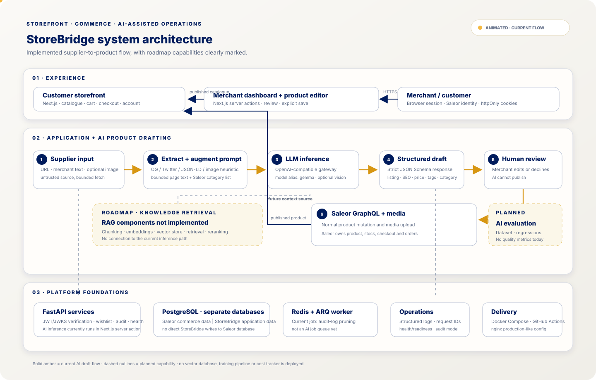

# StoreBridge

Commerce, connected intelligently. StoreBridge is an AI-powered ecommerce engineering project built around Saleor, FastAPI and Next.js. It combines a customer storefront and merchant dashboard with a supplier-aware AI product drafting workflow, while Saleor remains the system of record for commerce.

**Current status: active foundation with core commerce and AI-assisted product creation in progress.** The repository includes a Next.js storefront and dashboard, Saleor GraphQL integration, FastAPI services, and an AI-assisted product draft flow. The backend AI Studio, RAG, background AI workflows, and several operational capabilities remain planned. This README separates shipped behavior from roadmap items.

StoreBridge is released under the [MIT License](LICENSE). Forks and contributions are welcome. Start with [CONTRIBUTING.md](CONTRIBUTING.md), follow the [Code of Conduct](CODE_OF_CONDUCT.md), and report vulnerabilities privately using [SECURITY.md](SECURITY.md). Community notification setup and its GitHub API limitations are documented in [docs/COMMUNITY.md](docs/COMMUNITY.md).

## System Architecture

The diagram follows the implemented product drafting and publishing path. The animated amber packets represent the current supplier-to-draft-to-storefront flow. RAG, evaluation and inference-cost tracking are not implemented and are intentionally absent from the data path.



<details>
<summary>Architecture status and component notes</summary>

| Layer | Implemented now | Planned or not implemented |
| --- | --- | --- |
| Experience | Next.js customer storefront, account/cart/checkout flows, merchant dashboard and product editor | Further dashboard and AI Studio capabilities |
| Product drafting | Supplier URL fetch with SSRF protections; Open Graph, Twitter, JSON-LD and conservative gallery-image extraction; optional merchant text and image | Supplier APIs/connectors and broader ingestion automation |
| Model call | Server-side OpenAI-compatible gateway (LiteLLM-compatible configuration), `gemma` model selection, image input, prompt instructions and strict JSON-schema response format | Provider/model selection UI, configurable inference parameters, prompt versioning and gateway abstraction in the backend |
| Review and commerce | Generated values are prefilled into the normal product form; merchant reviews and explicitly saves/publishes through Saleor GraphQL | Approval queues, multi-step workflow automation and background AI jobs |
| Persistence and operations | Separate Saleor and StoreBridge PostgreSQL databases, Redis, structured backend logs, health checks and audit-log foundation | Vector store, evaluation/observability platform, token and cost accounting, media object storage configuration |
| Delivery | Docker Compose development and production-like stack; CI workflow | Production deployment is documented as a target configuration, not a verified live deployment |

</details>

## End-to-end AI product pipeline

1. A merchant opens **AI-Assisted Product** in the Next.js dashboard and supplies a description, a supplier URL, an image, or a combination.
2. On the server, StoreBridge fetches the supplier page through an SSRF-safe fetch helper with a timeout and size limit. It extracts product metadata from Open Graph/Twitter tags and JSON-LD, then uses a conservative image-gallery heuristic as a fallback. The page's visible text is bounded before it is included in the prompt. A merchant-uploaded image takes priority over a supplier image.
3. The server builds a prompt with the merchant's text, extracted supplier information, available Saleor category names, image input where provided, and instructions to avoid unsupported product claims.
4. StoreBridge calls the configured OpenAI-compatible LLM gateway over HTTPS from a Next.js server action. The request currently selects `gemma`, sets a 1,000-token output ceiling and requests strict JSON-schema output for title, description, category, SEO fields, suggested price and tags.
5. The returned JSON is parsed and mapped to the existing catalogue. Category names are matched against actual Saleor categories. Gateway errors and empty responses are returned to the UI as generation errors.
6. The merchant reviews and edits the draft in the standard product form. AI generation does not call the product-creation action and cannot publish by itself.
7. On the merchant's explicit save action, the normal Saleor GraphQL product mutation persists the product; images use the existing Saleor media upload flow. The storefront then reads published catalogue data from Saleor.

This is an assisted, synchronous drafting flow. It is not an autonomous agent, a model-training pipeline, or a background workflow today.

## RAG architecture

**Current status: not implemented.** The product assistant uses request-time supplier-page extraction and direct prompt context. The repository does not contain a document ingestion/indexing pipeline, chunking strategy, embedding model, vector database, similarity search, reranker, or retrieval evaluation. It should therefore be described as context augmentation from the submitted source page, not retrieval-augmented generation (RAG).

The architecture SVG marks a future knowledge-retrieval direction only as a dashed roadmap lane; it does not imply that a retriever is connected to inference.

## LLM configuration and prompt engineering

- `NODE_BASE_URL` and `NODE_AP_KEY` are server-only environment settings for the internal OpenAI-compatible gateway. The key is not sent to browser code.
- The current request selects the gateway model alias `gemma`. Model choice is a code constant; there is no merchant-facing model selector or provider failover implementation.
- The prompt uses a system role and a composed user message containing merchant input, extracted supplier facts, available category names and product-image input when present.
- Strict JSON Schema response formatting constrains the expected shape. The application parses the response and maps it to the product form; it does not currently use a separate schema-validation library on the returned JSON.
- `max_tokens` is set to 1,000 and the request has a 60-second timeout. Temperature and other sampling parameters are not currently configured.
- The prompt explicitly tells the model to avoid inventing specifications, certifications or measurements. This is a prompt instruction, not a guarantee of factual correctness; merchant review remains required.

## Supplier data ingestion

The implemented ingestion path begins with a merchant-provided product page URL, not a scheduled supplier feed. A bounded HTML fetch extracts title, description, price, brand and image candidates from common metadata formats. If structured metadata is missing, the parser can select a product-looking image based on conservative tag hints. The page text is stripped of scripts/styles and truncated before prompt construction. Supplier images are downloaded only when the merchant has not supplied an image.

The fetch helper rejects unsafe destinations and applies timeouts. Failed or unsupported supplier pages do not prevent generation from other submitted inputs. There are no implemented supplier credentials, catalog synchronization jobs, normalized supplier database, or ingestion queue.

## Workflow automation and human review

The AI product flow is deliberately human-in-the-loop: generation creates a draft, the merchant reviews the fields, and the standard form performs the Saleor save. There is no approval queue or autonomous publishing. The FastAPI ARQ worker and Redis are present, but its current scheduled job prunes old audit logs; AI generation is not queued there.

## Technology stack

| Area | Technology | Responsibility |
| --- | --- | --- |
| Storefront and merchant UI | Next.js 16, React 19, TypeScript | Server-rendered customer shopping and dashboard experiences; server actions keep credentials and commerce calls server-side |
| Commerce | Saleor 3.23, GraphQL | Catalogue, variants, inventory, checkout, orders, customers and staff identity |
| StoreBridge API | FastAPI, Pydantic, SQLAlchemy async, Alembic | StoreBridge-specific REST services, authentication verification, health and application data |
| Background processing | ARQ, Redis | Worker runtime; currently used for scheduled audit-log retention work |
| Relational data | PostgreSQL 16 | Separate databases and roles for Saleor and StoreBridge |
| AI integration | OpenAI-compatible gateway, configured model alias `gemma` | Server-side text/image product-draft inference with JSON-schema response mode |
| Validation and UI safety | Zod for selected form/actions; Pydantic API schemas; SSRF-safe supplier fetch | Boundary validation and safe supplier URL handling |
| Local orchestration | Docker Compose, Make and shell scripts | Development and production-like multi-service stack |

## Architecture and engineering decisions

- **Saleor owns commerce state.** StoreBridge reads and changes commerce data through Saleor GraphQL and does not write directly to Saleor's database.
- **Next.js is the server-side integration boundary.** The browser uses application routes and server actions; Saleor tokens live in `httpOnly` cookies, and API credentials stay on the server.
- **FastAPI owns StoreBridge-specific services.** It verifies Saleor-issued JWTs through JWKS, uses role-separated Postgres access, and provides readiness/liveness health endpoints. It currently does not host the AI product-generation endpoint.
- **The AI flow reuses the manual product path.** Generated suggestions prefill the same product form and use the same explicit Saleor save and media upload actions.
- **Supplier input is untrusted.** The fetch path includes SSRF controls, timeouts and input-size limits; extracted content is treated as prompt context rather than trusted instructions.
- **No vector database is introduced without a retrieval use case.** Current supplier context is ephemeral and comes directly from the submitted page.

More detailed decisions and trade-offs are in [docs/ARCHITECTURE.md](docs/ARCHITECTURE.md).

## Evaluation, observability and error handling

**AI evaluation status: not implemented.** The repository has tests for supplier metadata extraction and application behavior, but no golden dataset, LLM-as-judge workflow, factuality benchmark, prompt regression suite, or published model-quality metrics. The CI workflow validates software quality; it should not be described as measuring model quality.

Existing operational foundations include structured backend logs with request IDs, liveness/readiness checks for PostgreSQL, Redis and Saleor, typed API errors, a persistent audit-log model, and gateway errors surfaced to the product form. The current AI path does not record prompts/responses as traces, token usage, latency distributions, or inference cost. Avoid putting secrets or full customer records in logs or audit details.

## Deployment and CI/CD

Docker Compose defines the frontend, FastAPI API, ARQ worker, Saleor API and worker, PostgreSQL and Redis. Development mode also includes Mailpit. The recommended developer workflow runs the frontend and backend natively while infrastructure runs in containers; a fully containerized option is also available. The production override binds service ports to localhost for an nginx public entry point, disables Saleor debug mode, applies memory limits and removes direct database/Redis exposure.

GitHub Actions runs repository checks, including backend/frontend validation and Saleor GraphQL operation checks. The repository contains deployment configuration, but no evidence of a deployed environment or an automated release to a hosting provider. No dedicated MLOps deployment, model registry or model-training pipeline is present.

## Screenshots and demonstrations

The repository does not currently include maintained screenshots or a hosted demonstration link. Run the project locally using the instructions below to explore the current UI and AI-assisted product flow (requires gateway credentials for inference).

## Roadmap

The phases below reflect the project plan in [docs/ARCHITECTURE.md](docs/ARCHITECTURE.md); a roadmap item is not an implemented feature.

1. Foundation: repository, local stack, authentication and dashboard shell.
2. Core commerce: storefront, catalogue, cart, checkout, orders, inventory and customer workflows.
3. AI Studio: expanded generation tools and merchant-facing AI controls.
4. Payments and automation: regional payment integration, verified webhooks, notifications and follow-up workflows.
5. Analytics and refinement: reporting, performance, security review and deployment hardening.
6. Potential AI engineering extensions: retrieval-backed product knowledge, evaluation datasets and regression checks, provider/model configuration, and inference cost/latency tracking. These need design and implementation before they can be claimed as platform capabilities.

## Run it

You need Docker with Compose v2, Node 22, Python 3.12+, `make`, `openssl`, and about 4 GB of free memory.

```sh
make dev             # generates .env, starts Postgres/Redis/Saleor in Docker, runs
                     # backend/worker/frontend natively, waits for everything to be healthy
make saleor-admin    # create your staff account (first run only)
```

`make dev` (equivalently `./run_all.sh`) is the recommended development workflow. Postgres, Redis, Mailpit and Saleor run in Docker; the backend (`uvicorn --reload`) and frontend (`next dev`, Turbopack) run natively. This avoids Docker Desktop's host file-sharing layer interfering with file watching.

First-time native setup:

```sh
cd backend && python3 -m venv .venv && .venv/bin/pip install -e "[dev]"
cd ../frontend && npm ci
```

Other commands: `./scripts/stop-all.sh` (or `make stop`) stops the stack; `./scripts/health-check.sh` checks service health; `./scripts/logs.sh [backend|worker|frontend|infrastructure]` tails logs.

Alternatives:

```sh
make up               # fully dockerized development stack
make up-prod          # production-like local build, without bind mounts
```

| URL | Service |
| --- | --- |
| http://localhost:3000 | StoreBridge storefront/dashboard |
| http://localhost:8001/docs | StoreBridge API reference (development only) |
| http://localhost:8000/graphql/ | Saleor GraphQL playground |
| http://localhost:8025 | Mailpit development inbox |

Optional: `make saleor-sample-data` loads Saleor's development catalogue. `docker compose --profile tools up -d saleor-dashboard` starts Saleor's admin UI for catalogue management.

For AI-assisted product generation, configure `NODE_BASE_URL` and `NODE_AP_KEY` in the frontend environment with the internal OpenAI-compatible gateway endpoint and credential. The AI action is unavailable when these settings are empty.

## Verification

The repository documents backend lint/tests, frontend lint/typecheck/build, GraphQL schema validation and local end-to-end checks. Run the project checks with the commands defined in the Makefile and package scripts; AI model quality and live gateway behavior require separately configured credentials and are not established by CI.

## Repository layout

```text
backend/         FastAPI service, ARQ worker, Alembic migrations and tests
frontend/        Next.js storefront, dashboard, Saleor GraphQL client and AI product flow
infrastructure/  PostgreSQL initialization and reverse-proxy configuration
scripts/         Local stack bootstrap, health checks and run helpers
docs/            Architecture decisions and system diagrams
```

## Contributing

You can fork StoreBridge, make changes on a branch, and open a pull request. Issues and focused feature proposals are welcome. Please read [CONTRIBUTING.md](CONTRIBUTING.md) before submitting a change. This project welcomes community contributions while keeping direct repository write access limited to trusted collaborators.
