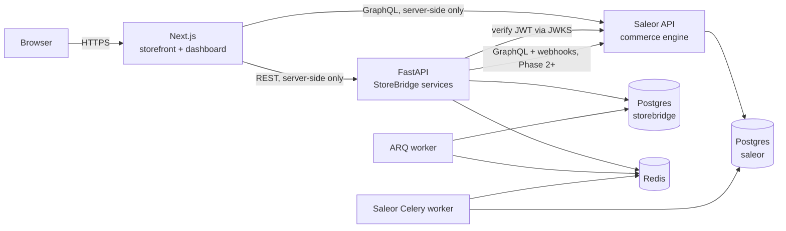

# StoreBridge architecture

Status: Phase 1 (foundation). This document records the decisions made so far and why.

## The shape of the system



| Part | Owns | Does not do |
| --- | --- | --- |
| **Saleor** | Products, variants, collections, stock, customers, orders, checkout, discounts, tax, staff accounts and permissions | AI, StoreBridge automation |
| **FastAPI service** | AI Studio, automation, payment-provider apps, audit log, anything StoreBridge-specific | Commerce records. It never writes to Saleor's database |
| **Next.js** | Storefront and dashboard UI. Calls both back ends from the server | Business rules, price maths, permission decisions |
| **ARQ worker** | Slow or scheduled work for the FastAPI service | |

One browser never talks to Saleor or FastAPI directly. Tokens stay in `httpOnly` cookies and
all API calls are made by Next.js on the server, so no API URL or token reaches client code.

## Saleor evaluation

**Decision: use Saleor 3.23 as the commerce engine.**

What it gives us without writing it: variants and attributes, multi-warehouse stock with
allocation at checkout (the overselling protection in the brief), server-side price and
discount calculation, order state machine, tax configuration, staff permissions, and an
app/webhook model for payments. It is Python, BSD-3 licensed, and its GraphQL API is designed
for exactly this "bring your own storefront and admin" arrangement.

Trade-offs to know about:

1. **It is single-tenant.** Saleor *channels* separate currencies and catalogues, but they
   are not a security boundary between unrelated merchants: staff permissions are global.
   Multi-store SaaS therefore means **one Saleor instance per merchant**, with the StoreBridge
   service routing to the right instance by store. Every StoreBridge table that holds
   merchant data will carry a `store_id` from the migration that creates it. Until there are
   several merchants, deploy one stack per client.
2. **It is heavy.** API + Celery worker + Postgres + Redis wants about 2 GB of RAM. That is
   more than a $5 VPS; budget for a 4 GB machine per stack, or Saleor Cloud.
3. **Payments are do-it-yourself for regional gateways.** Saleor has no Paynow or Pesepay
   integration. The plan (Phase 4) is a Saleor *payment app* implemented inside the FastAPI
   service: Saleor calls our signed synchronous webhooks to start and process a transaction,
   we call the gateway, and the gateway's own callback is verified before we report the
   charge back to Saleor. Saleor only marks the order paid from that report. This is the
   provider abstraction the brief asks for, at the boundary Saleor already defines.
4. **The admin is ours to build.** We render the dashboard in Next.js against Saleor's API.
   Until Phase 2 lands, Saleor's own dashboard is available behind the `tools` compose profile.

If a requirement turns out not to fit (most likely candidates: true shared multi-tenancy,
or hosting cost for very small merchants), the fallback is to implement a slim commerce core
in the FastAPI service. The Next.js data layer is isolated in `lib/saleor` and `features/*/data.ts`
so that swap would not touch UI components.

## Authentication and authorization

Saleor is the only identity provider. There is no second user table.

1. The sign-in form posts to a Server Action, which calls Saleor's `tokenCreate`.
2. The access token (short-lived, RS256) and refresh token are stored in `httpOnly`,
   `SameSite=Lax` cookies, `Secure` in production. JavaScript in the browser cannot read them.
3. `proxy.ts` does an optimistic check on `/dashboard/*`: no cookies means redirect to
   sign-in; an expiring access token is renewed with `tokenRefresh`.
4. The real check is `getCurrentUser()` in `lib/auth/session.ts`, which asks Saleor who the
   token belongs to and requires a staff account. Every component that renders store data
   calls it.
5. When Next.js calls the FastAPI service it forwards the access token. FastAPI verifies the
   signature against Saleor's JWKS (`/.well-known/jwks.json`), with the algorithm pinned to
   RS256, required claims enforced, and refresh tokens rejected. `require_staff` guards
   management endpoints.

Fine-grained permissions (for example "can manage orders") come from Saleor. Queries return
`null` for fields the user may not see, and the UI says "No access" rather than failing.

Known gaps, deliberately left for later phases: sign-in rate limiting at our edge (Phase 5
security review; Saleor applies its own), and audit entries for sign-in events.

## Data ownership

Two databases on one Postgres server, each with its own role (see
`infrastructure/postgres/init-databases.sh`). The `storebridge` role cannot read Saleor's
tables. When StoreBridge needs commerce data it asks Saleor's API, and it stores only Saleor
IDs as references.

StoreBridge's schema today is one table, `audit_logs`. Migrations are Alembic, in
`backend/migrations`.

## Front-end structure

```
frontend/
├── app/                  routes only: pages compose features, they hold no logic
├── features/<name>/      a feature's data access and components together
├── components/ui/        design-system primitives
├── components/shell/     dashboard chrome: sidebar, top bar, breadcrumbs, account menu
├── components/brand/     logo
├── lib/                  auth, Saleor client, navigation map, utilities
└── proxy.ts              session keep-alive (Next.js 16's name for middleware)
```

Next.js 16 runs with Cache Components on. The dashboard chrome prerenders as a static shell;
anything that reads the session streams in behind a `<Suspense>` boundary.

### Design system

Tokens live in `app/globals.css`. The rules:

- **Colour.** White and light grey surfaces. Deep navy `#000052` for structure (sidebar,
  headings). Teal `#00C9A3` for the primary action and focus ring, always with navy text on
  it, because white on teal fails contrast. Mint `#C5FCEE` for selected and positive states.
  Muted green `#4E8075` is reserved for charts in Phase 5. Teal is never used for body text;
  `teal-ink` is the accessible text variant.
- **Type.** Plus Jakarta Sans, self-hosted. 14px base in the dashboard, tabular figures for
  numbers.
- **Shape.** Two radii: `control` for buttons and inputs, `panel` for containers.
- **Status** is always written in words; colour only reinforces it.
- **States.** Every data view has loading, empty, no-permission and error states.

## Deviations from the brief, and why

| Brief | What was done | Reason |
| --- | --- | --- |
| TanStack Query, Zustand, React Hook Form | Not installed yet | Nothing in Phase 1 needs client-side server state, a cart, or complex forms. They arrive with the storefront in Phase 2 rather than sitting unused |
| shadcn/ui | Radix primitives with hand-written components in the same style | Only five primitives are needed so far; they follow shadcn's conventions, so the CLI can add more later |
| Font via Google | `@fontsource-variable/plus-jakarta-sans` | Builds without network access and sends no visitor data to Google |
| Nginx, S3 storage | Deferred | Needed for deployment and product media, which are Phase 5 and Phase 2 work |
| All sidebar sections | Present, but unbuilt ones open a page that says so | The brief rules out controls that do nothing |

## Roadmap

1. **Foundation** (this phase): repository, Docker stack, auth, design system, dashboard shell.
2. **Core commerce**: storefront, catalogue, cart, checkout, orders, inventory, customers.
3. **AI Studio**: descriptions, SEO, marketing content, support assistant.
4. **Payments and automation**: gateway app, verified webhooks, notifications, follow-ups.
5. **Analytics and refinement**: reporting, performance, security review, deployment.
